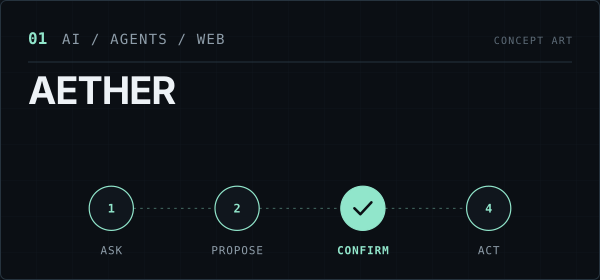
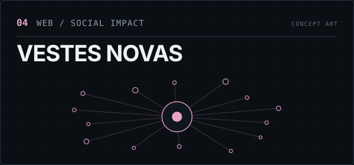

I'm Matias, a software engineer in São Paulo working at the intersection of engineering, product and AI. I build intelligent interfaces, AI agents and applied LLM features, across web and mobile, and ship independent products end to end. Open to opportunities.

<table>
<tr>
<td width="50%" valign="top"><b>BUILDING</b> AI-first products and SaaS</td>
<td width="50%" valign="top"><b>EXPLORING</b> LLMs, agents, applied AI</td>
</tr>
<tr>
<td width="50%" valign="top"><b>ENGINEERING</b> Software that's built to last</td>
<td width="50%" valign="top"><b>INTERESTS</b> Dev tools, indie hacking</td>
</tr>
</table>

### Selected work

<table>
<tr>
<td width="50%" valign="top">
 
An inbox assistant you talk to, and it only acts after you confirm. 
<a href="https://aether-rho-livid.vercel.app/">Live demo</a> · <a href="https://www.joaopedromatias.com/projects/aether">Case study</a>
</td>
<td width="50%" valign="top">
 
Open-source Claude Code skill that teaches any topic from first principles. 
<a href="https://github.com/jpmmatias/skills">Repository</a> · <a href="https://www.joaopedromatias.com/projects/learn-skill">Case study</a>
</td>
</tr>
<tr>
<td width="50%" valign="top">
 
A real-time 1v1 game played with your webcam, built in two weeks. 
<a href="https://www.joaopedromatias.com/projects/aura-farm-royale">Case study</a>
</td>
<td width="50%" valign="top">
 
Website and volunteer platform for a philanthropic project. 
<a href="https://vestes-novas.ong.br/">Visit site</a> · <a href="https://www.joaopedromatias.com/projects/vestes-novas">Case study</a>
</td>
</tr>
</table>

Card art is conceptual, not product screenshots. Some projects are private, so each links to a live site or case study.

### Stack

<table>
<tr><td valign="top"><b>AI</b></td><td>LLMs · AI agents · RAG · MCP · Vercel AI SDK · LangChain · OpenAI & Claude APIs · OpenRouter · MediaPipe · Agent Skills</td></tr>
<tr><td valign="top"><b>FRONTEND & MOBILE</b></td><td>TypeScript · React · Next.js · React Native · Tailwind CSS</td></tr>
<tr><td valign="top"><b>BACKEND & DATA</b></td><td>Node.js · Python · Go · Rust · FastAPI · Fastify · PostgreSQL · Drizzle · SQLite</td></tr>
<tr><td valign="top"><b>CRAFT</b></td><td>Playwright · accessibility testing · architecture decision records · AWS · Vercel · Railway · Claude Code</td></tr>
</table>

**[Portfolio](https://www.joaopedromatias.com/)** · **[LinkedIn](https://www.linkedin.com/in/joaopedromatias)** · **[GitHub](https://github.com/jpmmatias)** · **[X](https://x.com/joaopdmatias)**

