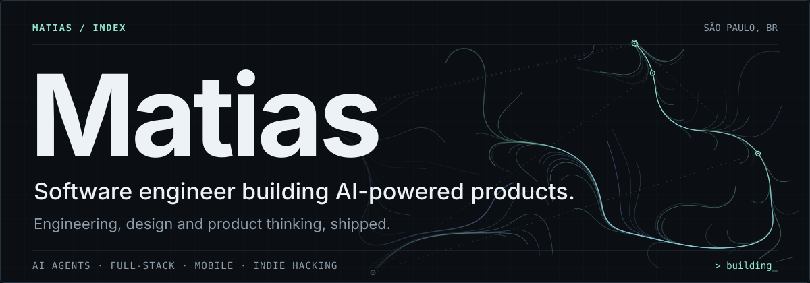
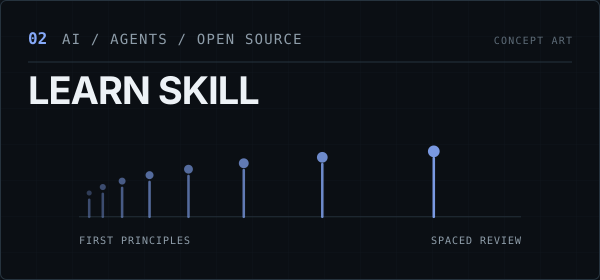
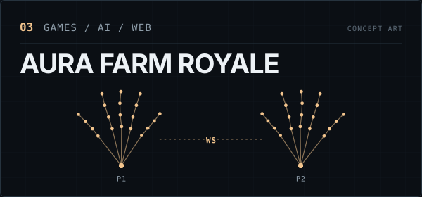

## 01 — About

I'm Matias, a software engineer in São Paulo working at the intersection of engineering, product and AI. I build intelligent interfaces, AI agents and applied LLM features, and I care as much about how a product feels to use as about how it's built.

I work across the whole stack, from frontend and mobile to the services and models behind them, and I ship independent products end to end. Remote-friendly, open to opportunities.

## 02 — Current focus

<table>
<tr>
<td width="50%" valign="top"><b>BUILDING</b> <b>AI-first products and SaaS</b> Software where the model proposes and the code acts.</td>
<td width="50%" valign="top"><b>EXPLORING</b> <b>LLMs, agents and applied AI</b> Tool use, agent workflows, agent skills.</td>
</tr>
<tr>
<td width="50%" valign="top"><b>ENGINEERING</b> <b>Software that's built to last</b> Clear architecture, tested behavior, accessible interfaces and decisions written down.</td>
<td width="50%" valign="top"><b>INTERESTS</b> <b>Product engineering</b> Developer tools and indie hacking.</td>
</tr>
</table>

## 03 — Selected work

<table>
<tr>
<td width="50%" valign="top">

<b>An inbox assistant you talk to.</b> 
Say what to clear, find or draft. Aether shows what it found and only acts after you confirm. 
Next.js · TypeScript · AI SDK · Claude · Gmail API · Postgres 
<a href="https://aether-rho-livid.vercel.app/">Live demo</a> · <a href="https://www.joaopedromatias.com/projects/aether">Case study</a>
</td>
<td width="50%" valign="top">

<b>An agent skill that teaches any topic.</b> 
Open-source skill for Claude Code that builds visual courses from first principles, with quizzes, spaced review and milestones. 
Claude Code · Agent Skills · JavaScript · HTML · CSS 
<a href="https://github.com/jpmmatias/skills">Repository</a> · <a href="https://www.joaopedromatias.com/projects/learn-skill">Case study</a>
</td>
</tr>
<tr>
<td width="50%" valign="top">

<b>A 1v1 game played with your webcam.</b> 
Two players, five meme challenges, hand and pose tracking scored by a server-authoritative engine. Built with a teammate in two weeks. 
Next.js · MediaPipe · WebRTC · WebSockets · FastAPI 
<a href="https://www.joaopedromatias.com/projects/aura-farm-royale">Case study</a>
</td>
<td width="50%" valign="top">

<b>Technology for a philanthropic project.</b> 
Website and volunteer platform for Vestes Novas, which supports children and young people affected by abandonment and violence. 
Next.js · TypeScript · Tailwind CSS · Fastify · SQLite 
<a href="https://vestes-novas.ong.br/">Visit site</a> · <a href="https://www.joaopedromatias.com/projects/vestes-novas">Case study</a>
</td>
</tr>
</table>

Card artwork is conceptual and does not show the products' interfaces. Some projects are in private repositories, so each links to a live site or a case study.

## 04 — Stack

<table>
<tr><td valign="top"><b>AI</b></td><td>LLMs · AI agents · RAG · MCP · Vercel AI SDK · LangChain · OpenAI & Claude APIs · OpenRouter · MediaPipe · Agent Skills</td></tr>
<tr><td valign="top"><b>FRONTEND & MOBILE</b></td><td>TypeScript · React · Next.js · React Native · Tailwind CSS</td></tr>
<tr><td valign="top"><b>BACKEND & DATA</b></td><td>Node.js · Python · Go · Rust · FastAPI · Fastify · PostgreSQL · Drizzle · SQLite</td></tr>
<tr><td valign="top"><b>CRAFT</b></td><td>Playwright · accessibility testing · architecture decision records · AWS · Vercel · Railway · Claude Code</td></tr>
</table>

## 05 — Elsewhere

**[Portfolio](https://www.joaopedromatias.com/)** · **[LinkedIn](https://www.linkedin.com/in/joaopedromatias)** · **[GitHub](https://github.com/jpmmatias)** · **[X](https://x.com/joaopdmatias)**

Let's build something that matters.

